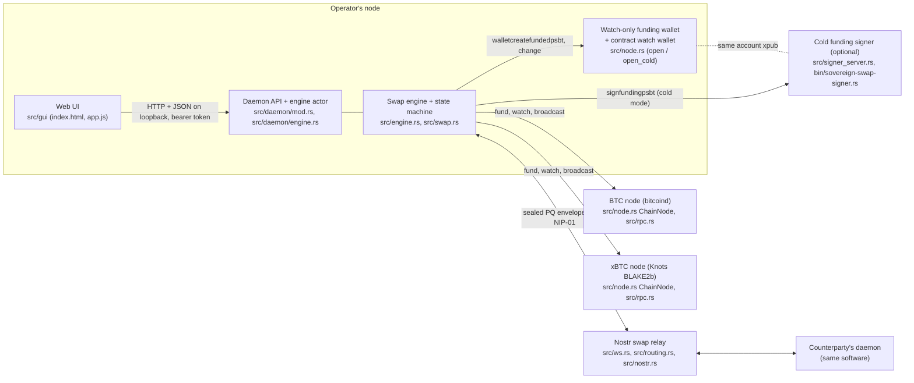
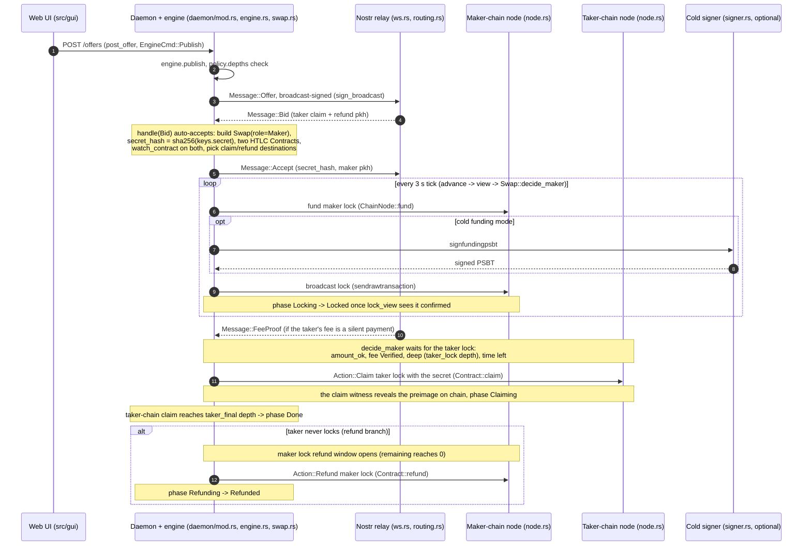
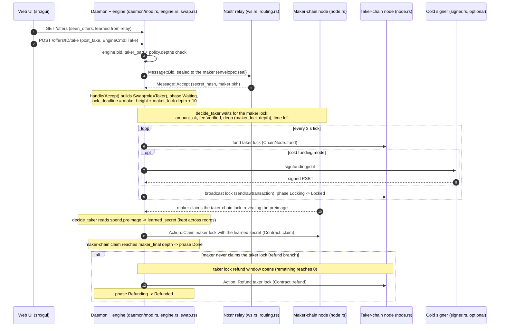
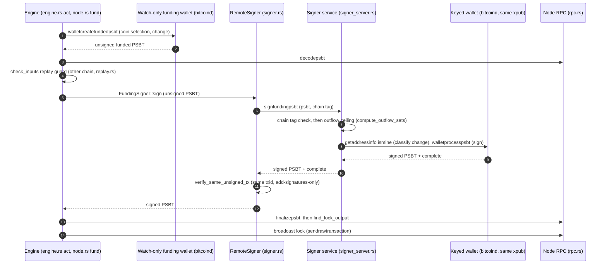

# Swap flow: maker and taker

How a cross-chain atomic swap between BTC and xBTC (Bitcoin Blake2b) runs end to end, for the
operator who drives it and for the developer who needs to know which module owns each step. Every
module and function named here is in the tree; the flow is a synthesis of the code, not of the design
notes (which it cites only for background).

The swap is a two-leg hash-timelock (HTLC) exchange. The maker locks first on its chain; the taker
locks second on the other chain; the maker claims the taker's lock, which puts the secret on chain;
the taker reads the secret from that spend and claims the maker's lock. Neither side can take both
legs: a lock that is not claimed in time is refunded to its owner. The decision at every step is the
pure function `Swap::decide` (`src/swap.rs`), which is level-triggered, so a restart, a dropped
broadcast or a reorg is handled by deciding again from the live chain state.

Both chains are bitcoind-family nodes (Bitcoin Core for BTC, Knots BLAKE2b for xBTC) and share
Bitcoin's address format, which is why several guards below are keyed on an explicit per-chain tag
rather than on address parsing.

---

## 1. Systems overview

| System | What it does | Main module |
|---|---|---|
| Web UI | A small single-page app served by the daemon on loopback; drives everything over the JSON API with the bearer token injected into the page. Create and take offers, watch swap phases live. | `src/gui/` (`index.html`, `app.js`, `app.css`) |
| Daemon + engine actor | Owns config and the engine, exposes the loopback HTTP API, and runs the engine on a 3 second tick in its own thread. The API never fabricates data: with no engine it answers "engine not running". | `src/daemon/mod.rs`, `src/daemon/engine.rs`, `src/daemon/types.rs` |
| Swap engine + state machine | Reads both chains into a `ChainView`, lets `Swap::decide` choose `Action`s, persists, then acts (fund / claim / refund / broadcast) and sends / receives protocol `Message`s. | `src/engine.rs`, `src/swap.rs`, `src/htlc.rs`, `src/keys.rs` |
| BTC node | A bitcoind the operator runs. Selects coins, signs (hot path), broadcasts, and tracks locks through a watch-only wallet. | `src/node.rs` (`ChainNode`, `ChainBackend`), `src/rpc.rs` |
| xBTC node | The Bitcoin Blake2b node (Knots BLAKE2b), reached exactly like the BTC node. | `src/node.rs`, `src/rpc.rs` |
| Watch-only funding wallet | Holds the operator's balance as watch-only descriptors (cold mode) or as a keyed wallet (hot mode), plus a second wallet that watches the per-swap contract addresses so the node tracks confirmations, spends and reorgs. | `src/node.rs` (`open`, `open_cold`, `lock_view`) |
| Nostr swap relay | An untrusted relay that carries offers (broadcast) and the per-swap messages (sealed to the peer). Reached Tor-first. Every guarantee rests on the post-quantum envelope, so a hostile relay can drop but not forge. | `src/ws.rs`, `src/routing.rs`, `src/nostr.rs`, `src/envelope.rs` (our own relay: `src/relay_server.rs`) |
| Cold funding signer | Optional separate service holding the funding keys. The daemon forwards an unsigned funding PSBT; the signer validates against a policy ceiling and signs. Key separation, not air-gap. | `src/signer.rs` (`RemoteSigner`), `src/signer_server.rs`, `src/bin/sovereign-swap-signer.rs` |

A note on keys, stated honestly up front. The cold signer protects only the funding balance. The
per-swap claim and refund keys are derived in the engine (`src/keys.rs`, `Use::Claim` / `Use::Refund`)
and used inline in `Engine::act` to sign claim and refund transactions; they are online. So a full
compromise of the engine host can propose funding PSBTs (bounded by the signer's outflow ceiling) and
can move value already committed to a per-swap HTLC, but it cannot spend the funding balance.

---

## 2. Maker flow

The maker publishes an offer, and its daemon automatically accepts any valid bid on it (there is no
manual "accept" click). The maker locks first, then claims the taker's lock to reveal the secret.

| Step | System | Module / function | Message / Action | What happens |
|---|---|---|---|---|
| Configure | UI -> Daemon | `daemon/mod.rs` `Daemon::open`, `start_engine`; `types.rs` `Settings`, `FundingConfig` | - | Operator sets both node endpoints, a relay, and per-chain funding mode (`hot` default or `cold` with a signer endpoint + account descriptors). The daemon opens each node (`ChainNode::open` hot, or `open_cold` watch-only), the relay (`WsConn` + `RelayTransport`), and `Engine::open`. |
| Post offer | UI -> Engine | `daemon/mod.rs` `post_offer`; `daemon/engine.rs` `EngineCmd::Publish`; `engine.rs` `Engine::publish`; `types.rs` `NewOffer::into_swap_offer` | `Message::Offer` | The form becomes an `Offer` (amounts, per-leg lock blocks sized from policy, and `fee` terms from settings when the fee is on). `policy.depths` validates it, then `transport.send` broadcasts it. `RelayTransport` broadcast-signs the offer (`envelope::sign_broadcast`) and `WsConn` publishes it as a Nostr event. |
| Receive a bid | Relay -> Engine | `engine.rs` `tick` -> `transport.receive` -> `handle`; `routing.rs` `RelayTransport::receive` | `Message::Bid` | A bid arrives sealed to the maker; the relay layer verifies the envelope and records the peer for this swap. The bid carries the taker's claim and refund pubkey-hashes and the `maker_part` being taken. |
| Accept (automatic) | Engine | `engine.rs` `handle(Message::Bid)`, `start`; `keys.rs` `secret`, `pkh`; `htlc.rs` `Contract` | `Message::Accept` | The daemon builds the `Swap` (`Role::Maker`), derives `secret_hash = sha256(keys.secret(index))`, and the two HTLC `Contract`s (maker lock on the maker chain, taker lock on the other). `start` registers both contract addresses with the watch wallet (`watch_contract`) and picks claim/refund destinations (`new_destination`), then sends `Accept` with the secret hash and the maker's pubkey-hashes. There is no human gate here. |
| Fund the maker lock | Engine -> Maker node (+ signer) | `engine.rs` `advance`, `act`; `swap.rs` `decide_maker`; `node.rs` `ChainNode::fund`, `FundingSigner`; `replay.rs` `check_inputs` | `Action::Fund` | `decide_maker` returns `Fund` while in `Locking`. `fund` builds the lock PSBT on the funding wallet (`walletcreatefundedpsbt`), runs the replay guard against the other chain (`check_inputs`), signs via `FundingSigner` (hot `WalletSigner`, or cold `RemoteSigner` to the signer service), finalizes and checks the lock output. `act` then broadcasts it. The signed lock and any fee proof are stored, so a restart rebroadcasts the same transaction. |
| Watch confirmations | Engine -> Maker node | `engine.rs` `view`; `node.rs` `lock_view` (`listtransactions` on the watch wallet) | - | Each tick re-reads the lock from the node. `decide_maker` moves `Locking -> Locked` once the lock is on chain. |
| Verify the taker lock | Engine -> Taker node | `engine.rs` `view`, `fee_state`; `swap.rs` `decide_maker`, `FeeState` | - | When the taker's lock appears, `view` sets its `FeeState`. `decide_maker` reveals only if the lock has the agreed amount (`amount_ok`), its fee is `Verified` or `NotRequired`, it is at least `taker_lock` deep, and enough blocks remain for the claim to become final before the taker's refund opens. |
| Reveal / claim | Engine -> Taker node | `engine.rs` `act`; `swap.rs` `decide_maker`; `htlc.rs` `Contract::claim`; `keys.rs` `key(.., Use::Claim)` | `Action::Claim` | The maker claims the taker's lock with the secret. The claim's witness exposes the preimage on the taker chain. Phase `Claiming`. Once the secret is public the maker keeps claiming regardless of the clock or fee state (or the taker could take both legs). |
| Complete | Engine -> Taker node | `swap.rs` `decide_maker`, `final_or` | - | When the claim reaches `taker_final` depth, phase `Done`. |
| Refund branch | Engine -> Maker node | `swap.rs` `decide_maker`; `engine.rs` `act`; `htlc.rs` `Contract::refund`; `keys.rs` `key(.., Use::Refund)` | `Action::Refund` | If the taker never locks, once the maker lock's refund window opens (`remaining <= 0` and not already claiming) the maker refunds its own lock. Phase `Refunding -> Refunded`. |

---

## 3. Taker flow

The taker browses the relay's order book, bids on an offer, waits for the maker's lock, locks second,
then learns the secret from the maker's claim and claims the maker's lock.

| Step | System | Module / function | Message / Action | What happens |
|---|---|---|---|---|
| Browse market | UI -> Engine | `daemon/mod.rs` `get_offers`; `daemon/engine.rs` `EngineCmd::Offers`; `engine.rs` `seen_offers`, `handle(Message::Offer)` | `Message::Offer` (inbound) | Offers discovered on the relay are kept in `seen_offers`; the UI lists them. The UI's Take button bids the full offer amount (`amount_sat`). |
| Take / bid | UI -> Engine -> Relay | `daemon/mod.rs` `post_take`; `daemon/engine.rs` `EngineCmd::Take`; `engine.rs` `Engine::bid`; `routing.rs` `RelayTransport::send` | `Message::Bid` | `bid` refuses a bid on the taker's own offer, computes `taker_part`, validates `policy.depths`, records the pending bid, and sends a `Bid` carrying a fresh `swap_id` and the taker's claim and refund pubkey-hashes. The relay layer seals it to the maker (`envelope::seal`) and addresses it by the maker's routing key (`p_tag`). |
| Receive Accept | Relay -> Engine | `engine.rs` `handle(Message::Accept)`, `start`; `node.rs` `ChainBackend::height` | `Message::Accept` | On the maker's `Accept`, the taker builds the `Swap` (`Role::Taker`) in phase `Waiting` and sets `lock_deadline = maker-chain height + maker_lock depth + LOCK_WAIT_BLOCKS` (10). It then watches both contracts. |
| Verify + fund the taker lock | Engine -> Taker node (+ signer) | `swap.rs` `decide_taker`; `engine.rs` `view`, `fee_state`, `act`; `node.rs` `ChainNode::fund`; `replay.rs` `check_inputs` | `Action::Fund` | The taker locks only once the maker's lock is deep (`maker_lock` depth), has the agreed amount, its fee is `Verified`/`NotRequired`, and enough blocks remain for the taker lock to run and a claim to become final. Funding uses the same PSBT pipeline as the maker. A wrong amount or a failed fee abandons; a pending fee only waits, bounded by `lock_deadline`. |
| Watch the maker claim | Engine -> Maker node | `swap.rs` `decide_taker`; `node.rs` `lock_view`, `extract_preimage` | - | The maker claims the taker's lock; its spend carries the preimage. `decide_taker` reads `spend.preimage` and stores `learned_secret`, which is kept even if a reorg removes the spend. |
| Claim the maker lock | Engine -> Maker node | `swap.rs` `decide_taker`; `engine.rs` `act`; `htlc.rs` `Contract::claim`; `keys.rs` `key(.., Use::Claim)` | `Action::Claim` | With the secret and the maker's lock still unspent, the taker claims the maker's lock on the maker chain. Phase `Claiming`. |
| Complete | Engine -> Maker node | `swap.rs` `decide_taker`, `final_or` | - | When the taker's claim reaches `maker_final` depth, phase `Done`. |
| Refund branch | Engine -> Taker node | `swap.rs` `decide_taker`; `engine.rs` `act`; `htlc.rs` `Contract::refund`; `keys.rs` `key(.., Use::Refund)` | `Action::Refund` | If the maker never claims the taker's lock, once the taker lock's refund window opens the taker refunds it. Phase `Refunding -> Refunded`. If the maker never locks at all, or locks wrongly, the taker never locked, so it simply moves to `Abandoned`. |

---

## 4. Cold-funding detail

Both locks are funded through `ChainNode::fund`. In hot mode a `WalletSigner` signs with the node
wallet's own keys. In cold mode the funding wallet is watch-only (`ChainNode::open_cold`), so the
engine builds the funded PSBT but holds no funding key; a `RemoteSigner` forwards it to a separate
signer service that holds the keys, validates it against a policy ceiling, and signs. The engine
finalizes and broadcasts. The signer finalizes nothing and may only add signatures.

What each module owns:

- `src/engine.rs` `act` builds the fee output arguments (if any) and calls `ChainNode::fund`, then
  `ChainBackend::broadcast`.
- `src/node.rs` `ChainNode::fund` runs `walletcreatefundedpsbt`, the `check_inputs` replay guard
  (`src/replay.rs`, against the other chain's node so a coin spendable on both is refused), then
  `FundingSigner::sign`, then `finalizepsbt` and `find_lock_output`.
- `src/signer.rs` `RemoteSigner::sign` sends `signfundingpsbt { psbt, chain }` over the node transport
  (`src/rpc.rs` `Client`, so HTTPS to a LAN Root CA or a Tor onion through the SOCKS proxy), then
  enforces `verify_same_unsigned_tx` so the signer cannot rewrite the funding. `RemoteSigner::probe`
  (`getsignerinfo`) runs at daemon start, so an unreachable signer refuses to start rather than ever
  falling back to hot.
- `src/signer_server.rs` `SignerService::sign_funding` checks the `chain` tag first (both chains report
  `main`, so a crossed config is dangerous), then the outflow ceiling (`compute_outflow_sats` sums
  every output that is not the wallet's own plus the miner fee, ownership decided by asking the keyed
  wallet, never by trusting the PSBT's derivation fields), then signs with `walletprocesspsbt`. A
  refusal is a typed JSON-RPC error mapped to `SignerError` (`src/node.rs`), never a silent success.
- `src/bin/sovereign-swap-signer.rs` is the runnable service: config from the environment, loopback by
  default, an outflow ceiling via `SIGNER_MAX_SATS`.

Honest limit: `RemoteSigner` implements only `sign`, so it uses the trait default for
`sign_with_silent_fee`, which refuses as "not BIP352-aware". A silent-payment fee needs the input keys
at signing time, which the cold signer does not expose this way. So cold funding works with a
normal-address fee or with no fee; a silent-payment fee output under cold funding fails at funding.
Hot `WalletSigner` supports the silent-payment fee because it derives the input keys from the node
wallet's descriptors.

---

## 5. The voluntary fee

The fee is opt-in and belongs to the maker's offer. When the operator enables it
(`Settings::fee_enabled`, per-side basis points, and a per-chain address), `NewOffer::into_swap_offer`
(`src/daemon/types.rs`) copies the terms into `Offer.fee` as `FeeTerms` (`src/swap.rs`), so both sides
pay and verify against the offer's terms, never against one side's local settings (design 0010, 0013).
The fee is an extra output the payer funds on its own lock, never carved out of the swapped amount,
and each side pays on the chain it locks: the BTC-locking side pays to `btc_address`, the
xBTC-locking side to `xbtc_address`. Keeping the two addresses as separate fields is deliberate,
because both chains share Bitcoin's address format and could otherwise be confused (design 0013).

Where it is added: `src/engine.rs` `act` computes the amount with `fee::fee_amount` (`src/fee.rs`: a
per-side rate, a 1,000 sat floor, and a 100,000 sat minimum trade; a fee configured on a smaller trade
makes funding fail loudly rather than lock without the fee) and passes it to `ChainNode::fund`
(`src/node.rs`), which adds the output. A normal address is paid directly as its own output; a silent
payment (`sp1...`) needs the BIP352 path in `WalletSigner::sign_with_silent_fee`, which derives the
fresh unlinkable output, its ECDH share and its BIP374 proof (`src/silentpayments.rs` `pay_fee`),
carried to the counterparty in `Message::FeeProof` and re-sent each tick.

Where it is verified: `src/engine.rs` `fee_state` sets the counterparty lock's `FeeState`. A normal
address is checked directly, the counterparty's lock must carry an output paying the agreed address at
least the required amount. A silent payment is checked against the received proof
(`silentpayments::verify_fee`, authenticating the lock's input public keys from the proof's prevout
transactions). The result gates `Swap::decide`: the taker requires the maker's lock fee `Verified`
before it locks, and the maker requires the taker's lock fee `Verified` before it reveals the secret;
a `Failed` fee abandons, a `Pending` one only waits. Once the maker is already `Claiming` the secret
is public, so it keeps claiming whatever the fee state.

(Collecting a silent-payment fee the operator has earned needs daemon-side chain scanning, which is a
separate concern from the swap flow and is design 0013's main subject.)
